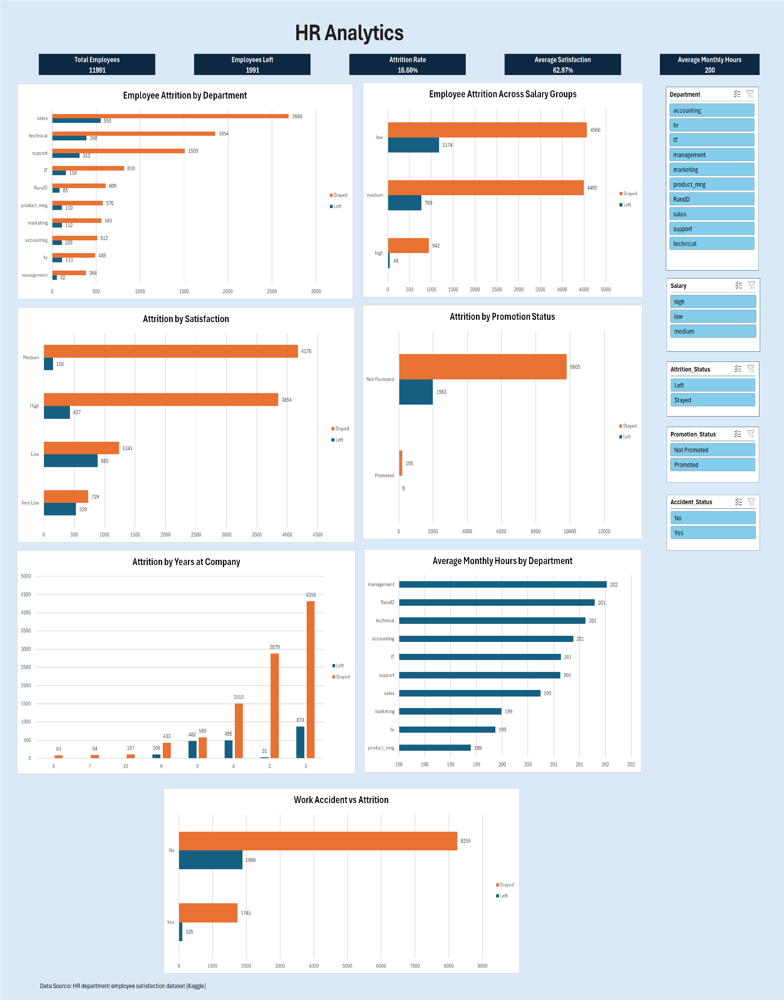

# 👥 HR Analytics Dashboard

## 📌 Project Overview

This project analyzes employee attrition trends using Human Resources data and an interactive Microsoft Excel dashboard. The objective is to identify the key factors influencing employee turnover and provide actionable business insights to improve employee retention.

## 🎯 Objectives

- Measure overall employee attrition.
- Identify departments with the highest turnover.
- Analyze the impact of salary on retention.
- Evaluate the relationship between employee satisfaction and attrition.
- Assess the effect of promotions on employee retention.
- Examine attrition patterns based on tenure.
- Investigate the relationship between work accidents and employee turnover.

## 📊 Dashboard KPIs

| KPI | Value |
|------|------:|
| Total Employees | 11,991 |
| Employees Left | 1,991 |
| Attrition Rate | 16.60% |
| Average Satisfaction | 62.97% |
| Average Monthly Hours | 200 |

## 📈 Dashboard Preview

## 🔍 Key Insights

### Employee Satisfaction
Employees with Low and Very Low satisfaction levels showed significantly higher attrition rates than employees with Medium and High satisfaction levels.

### Salary Impact
Employees in the Low Salary category experienced the highest turnover, indicating compensation may be an important retention factor.

### Promotion Impact
Employees who received promotions demonstrated substantially lower attrition rates compared to employees who were not promoted.

### Tenure Analysis
Employee attrition peaked around the fifth year of service, suggesting an increased risk of turnover among mid-tenure employees
